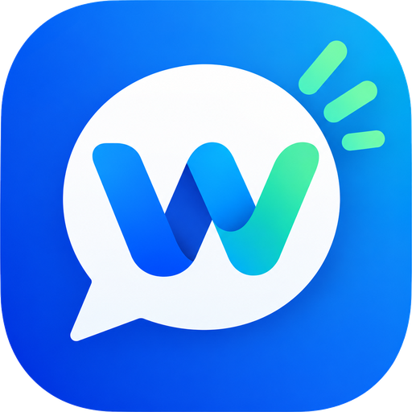
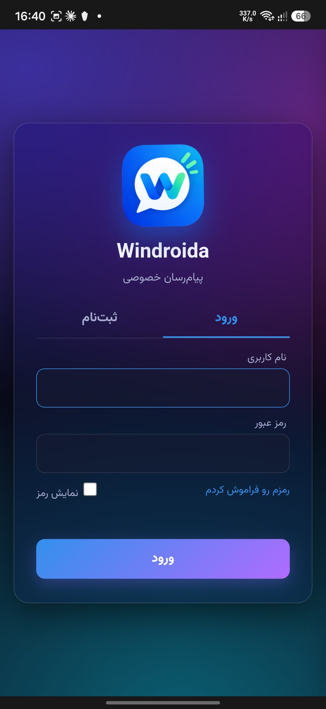
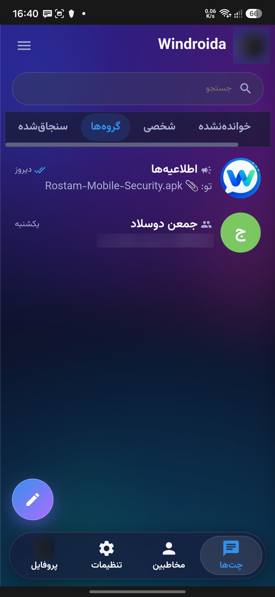
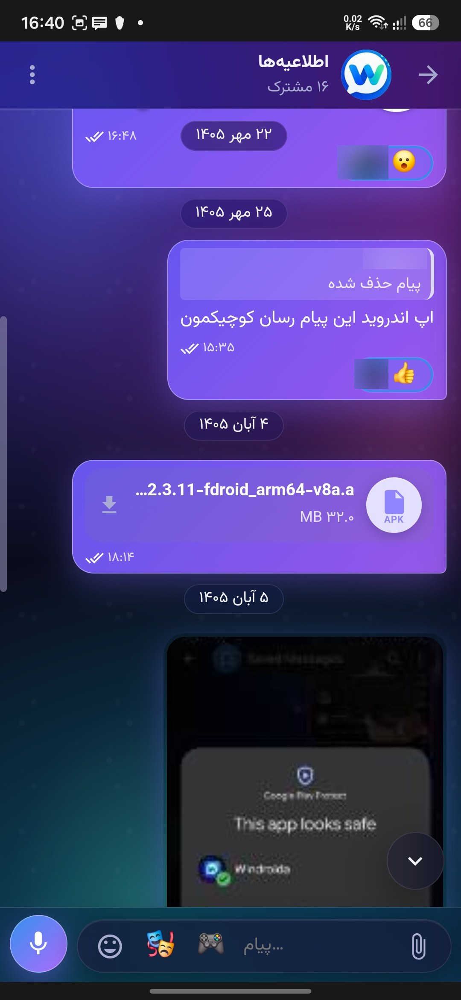
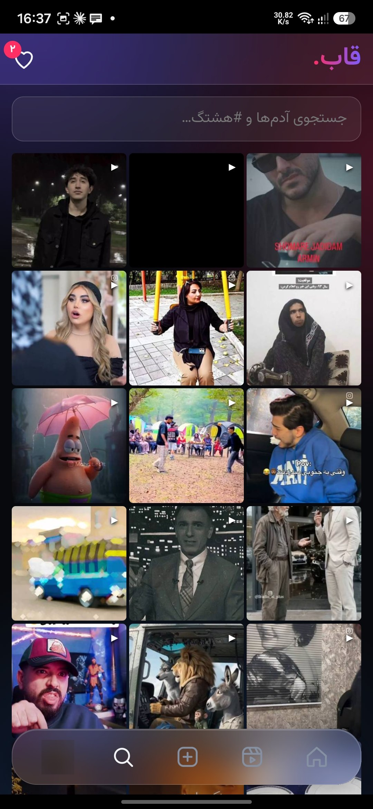
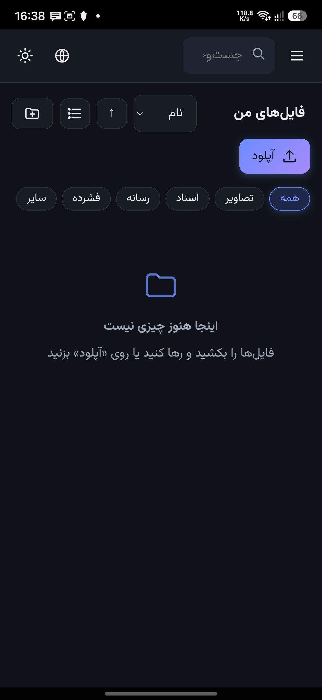

<div align="center">



# Windroida

**A private, self-hosted messenger — Telegram-style chat, Instagram-style Ghab, Google-Drive-style cloud. One click to run.**
**پیام‌رسان خصوصی و خودمیزبان — چت، قاب (شبیه اینستاگرام) و فضای ابری، همه با یک کلیک**

[](https://t.me/windroida)
[](https://instagram.com/windroida)
[](https://youtube.com/@windroida)


<br/>

    

</div>

---

## ✨ What is Windroida?

Windroida is a complete messaging platform that runs on **your own PC or server** — no cloud, no third party. It ships as three services that share one login (SSO):

| Service | What it is | Default port |
|---|---|---|
| 💬 **Windroida** | Messenger: chats, groups, channels, calls, games, mini apps | `8081` (HTTPS web) · `8765` (WebSocket) |
| 🖼️ **Ghab (قاب)** | Instagram-like social app: posts, reels, stories, hashtags, explore | `8084` |
| ☁️ **Cloud Drive (فضای ابری)** | Google-Drive-like file storage with quotas and resumable uploads | `8082` |

Plus a **native Android app** (Kotlin, glassmorphism design) and an **admin datasheet** for the owner.

## 🚀 Features

**Messenger**
- Private chats, groups, announcement channels, saved messages, pinned chats, mute, unread filters
- Reactions, replies, edit, delete-for-all, forward (no file duplication), pin, search, jump-to-message
- Rich text: **bold**, *italic*, ~~strike~~, `code`, code blocks, spoilers, links, @mentions
- Voice messages with waveform, speed control and "heard" receipts
- **Audio & video calls** relayed through your own server (no STUN/TURN needed), auto-rejoin on bad networks, group calls
- Watch & listen **rooms** (shared video/music, mic, cloud files)
- Built-in games: **Chess, Mafia, Mensch (Ludo)** — play in a chat or a room
- Polls in groups, stickers, animated/live emoji, custom chat wallpapers, light/dark themes
- Group privacy: invite links first, direct-add only if the user allows (everyone / contacts / nobody)
- Resumable uploads with progress, files kept locally on the phone, offline cache + auto-reconnect

**Ghab (قاب)**
- Posts, reels pager, stories, likes, comments, hashtags & people search
- Share a reel straight into any Windroida chat
- Admin panel with CSV export, automatic DB backups and migrations

**Cloud Drive**
- Folders, previews, per-user quota, chunked & resumable uploads, no per-file limit
- Admin panel, backups, optional malware-scan hook, Docker / Caddy / Nginx configs included

**Android app**
- Native UI (Chat, Contacts, Games, Ghab, Settings), Telegram-style page transitions
- Share-to-Windroida from other apps, background notifications, music player service
- Web mode as a fallback inside the app

**Security**
- HTTPS with an auto-generated self-signed certificate (needed for mic/camera in browsers)
- Passwords stored as **scrypt** hashes — never in plain text
- Rate limiting, input validation, and bundled pentest scripts (`pentest_gateway.py`, `pentest_ghab.py`)

## 📦 Installation

> Requirements: **Python 3.9+**. Pillow and cryptography are installed automatically on first run.

### 🪟 Windows
1. Install [Python 3.9+](https://www.python.org/downloads/) (tick **Add python.exe to PATH**).
2. Download / clone this repo and **double-click `start.bat`**.
3. Open the printed address, e.g. `https://192.168.1.100:8081` (browser warning for the self-signed certificate: **Advanced → Continue**).

Run at boot: `install-autostart.bat` (starts at login) or, as Administrator, `install-service.bat` (Windows service). Remove with `uninstall-autostart.bat` / `uninstall-service.bat`.

### 🐧 Linux
```bash
sudo apt update && sudo apt install -y python3 python3-pip python3-tk git   # tk only for the datasheet GUI
git clone https://github.com/<your-username>/windroida.git
cd windroida
chmod +x start.sh
./start.sh
```
Run as a service (`/etc/systemd/system/windroida.service`):
```ini
[Unit]
Description=Windroida
After=network-online.target

[Service]
WorkingDirectory=/opt/windroida
ExecStart=/usr/bin/python3 start.py --no-datasheet
Restart=always
Environment=WINDROIDA_ADMIN_PASSWORD=change-me-please-123

[Install]
WantedBy=multi-user.target
```
```bash
sudo systemctl enable --now windroida
```

### 🍎 macOS
Same as Linux (`brew install python python-tk`, then `./start.sh`).

### 📱 Android
1. **Download the APK** from the repo's *Releases* page (or build it yourself, below) and install it (allow "install unknown apps").
2. Open the app → enter your server address `https://your-server:8081` → log in.
3. Build it yourself:
   - **GitHub Actions:** *Actions → Build Windroida APK → Run workflow* → download the `windroida-apk` artifact. For a permanent signed release add the secrets `WD_KEYSTORE_B64`, `WD_KS_PASS`, `WD_KEY_ALIAS`, `WD_KEY_PASS`.
   - **Android Studio:** open the `android/` folder → *Build → Build APK*.
   - Details: [`android/README-android.md`](android/README-android.md)

### 🌐 Browser / iPhone
Open `https://your-server:8081` — the web client is a full PWA (Add to Home Screen).

### Launcher options

| Flag | Meaning |
|---|---|
| `--local` | only this computer |
| `--http` | plain HTTP (mic/calls then work only on localhost) |
| `--no-drive` / `--no-ghab` / `--no-datasheet` | skip a service |
| `--browser` | also open the web UI |
| `--no-install` | don't install Python packages |

**Friends outside your network:** forward TCP port `8081` on your router to the PC and share `https://YOUR-PUBLIC-IP:8081`. For a domain name: `WINDROIDA_CERT_NAMES=my.domain.com`.

## 🔑 Admin account

On the **first run** Windroida creates the owner account automatically:

| | |
|---|---|
| **Username** | `windroida` (change with `WINDROIDA_ADMIN`) |
| **Password** | **random**, generated on first start — printed in the console **once** and saved in `data/admin_password.txt` |

- To choose your own password instead, set `WINDROIDA_ADMIN_PASSWORD` **before the first start**.
- Log in, then change it: *Profile → Change password*, and delete `data/admin_password.txt`.
- This is the only account that can post in the **announcements** channel (every user is a member).
- There is no hard-coded default password in the code.

## 🗃️ Admin datasheet

`datasheet.py` is a **local desktop app** (Tkinter) for the server owner: users, chats, messages, files, rooms, Ghab posts/reports, Cloud Drive usage, CSV export, backups, orphan-file cleanup and temporary-password reset.

- It asks for a password at startup. On the **first run a random password is generated**, printed once and saved in `data/datasheet_password.txt`; only a salted PBKDF2 hash is stored (`data/datasheet_auth.json`). Nothing is hard-coded.
- Set your own with `WINDROIDA_DATASHEET_PASSWORD`. After 5 wrong tries it closes.
- It starts with `start.bat` / `start.sh` (skip with `--no-datasheet`; on a headless server don't run it). Linux needs `python3-tk`.
- It opens the local database files directly and listens on no port. Never expose the `data/` folders.
- Resetting a user's password generates a **random temporary password** for you to hand over.

### ⚙️ Configuration

| Variable | Default | Purpose |
|---|---|---|
| `WINDROIDA_ADMIN` | `windroida` | Owner username (posts in announcements) |
| `WINDROIDA_ADMIN_PASSWORD` | random | Owner password for the first start |
| `WINDROIDA_DATASHEET_PASSWORD` | random | Datasheet password (overrides the generated one) |
| `WINDROIDA_CERT_NAMES` | – | Extra hostnames for the HTTPS certificate |
| `WINDROIDA_CALL_GRACE` | `60` | Seconds a call waits for a dropped user to return |
| `WINDROIDA_DRIVE_PORT` / `WINDROIDA_GHAB_PORT` | `8082` / `8084` | Service ports |

Cloud Drive: copy `cloud-drive/.env.example` to `.env`. Never commit `.env`, `data/`, `*.key`, `*.crt` or `*.jks` (already in `.gitignore`).

## ✅ Do / ❌ Don't

**Do**
- Change the random admin password after the first login and delete `data/admin_password.txt`.
- Use HTTPS (default). Mic, camera and calls need it.
- Back up `data/`, `ghab/data/` and `cloud-drive/data/` regularly — that is all your users' data.
- Expose only the ports you need (`8081`; add `8082` / `8084` only if friends need Drive / Ghab).
- Keep the Android signing key private; store it only in GitHub *Secrets*.
- Run `pentest_gateway.py` and `pentest_ghab.py` against your own server after changes.

**Don't**
- Don't commit `data/`, `*.db`, `*.key`, `*.crt`, `*.jks`, `.env`, `keystore.properties` or `admin_password.txt` / `datasheet_password.txt`.
- Don't use `--http` on a public server.
- Don't share the datasheet password or the SSO keys (`data/drive_sso.key`).
- Don't forward ports on a machine you don't update.
- Don't delete files in `data/uploads/` by hand — forwarded messages share files.

## 🗂️ Project layout

```
server.py · webgw.py       WebSocket server + HTTP gateway
rooms.py · games.py        watch/listen rooms, chess / mafia / mensch engines
polls.py · groupadmin.py   polls, group administration
start.py / start.bat / start.sh   one-click launcher
datasheet.py               owner-only admin GUI
web/                       web client (plain HTML/CSS/JS, no build step)
ghab/                      Ghab social app (Flask)
cloud-drive/               Cloud Drive (Flask)
android/                   native Android app (Kotlin)
docs/                      screenshots + full Persian manual
test_*.py                  test suite
```

Developer docs (Persian): [`DEVELOPER_GUIDE.md`](DEVELOPER_GUIDE.md) · Full user manual (Persian): [`docs/MANUAL.fa.md`](docs/MANUAL.fa.md)

## 🧪 Tests

```bash
pip install pillow cryptography
python test_core.py && python test_security.py
```

## 📄 License

[MIT](LICENSE) © 2026 **windroida**

## 🌐 Community

<p>
<a href="https://t.me/windroida"></a>
<a href="https://instagram.com/windroida"></a>
<a href="https://youtube.com/@windroida"></a>
</p>

---

<div dir="rtl">

## 🇮🇷 فارسی

**ویندروید** یه پیام‌رسان کامل و خصوصیه که روی کامپیوتر یا سرور خودت اجرا می‌شه؛ بدون ابر و بدون واسطه. سه سرویس با یک ورود مشترک: **پیام‌رسان**، **قاب** (شبیه اینستاگرام) و **فضای ابری** (شبیه گوگل درایو)، به‌علاوه اپ اندروید بومی و دیتاشیت مدیریت.

### اجرا
- **ویندوز:** فقط `start.bat` رو دابل‌کلیک کن.
- **لینوکس / مک:** `./start.sh`

بعد از بالا اومدن، آدرس‌ها تو پنجره چاپ می‌شن (مثلاً `https://192.168.1.100:8081`). بار اول مرورگر درباره گواهی خودامضا هشدار می‌ده: **Advanced ← Continue**.

### امکانات
- چت خصوصی، گروه، کانال، پیام‌های ذخیره‌شده، ری‌اکشن، پاسخ، ویرایش، فوروارد، سنجاق
- پیام صوتی، تماس صوتی و تصویری از طریق خود سرور، اتاق تماشا و گوش‌دادن
- بازی‌های شطرنج، مافیا و منچ، نظرسنجی، استیکر و ایموجی زنده
- قاب: پست، ریلز، استوری، جستجوی آدم‌ها و هشتگ، اشتراک ریلز تو چت
- فضای ابری: پوشه، پیش‌نمایش، سهمیه برای هر کاربر، آپلود ادامه‌دار
- اپ اندروید بومی با ظاهر شیشه‌ای، اعلان، پخش آهنگ و کش آفلاین
- رمزها با scrypt هش می‌شن؛ اسکریپت‌های تست نفوذ هم داخل پروژه‌ست

### نکته مهم
### ادمین
بار اول که اجرا کنی، حساب مالک خودکار ساخته می‌شه: نام کاربری **`windroida`** و یه **رمز تصادفی** که یک‌بار تو کنسول چاپ می‌شه و تو `data/admin_password.txt` ذخیره می‌شه. وارد شو، از *پروفایل ← تغییر رمز* عوضش کن و فایل رو پاک کن. (برای رمز دلخواه، قبل از اولین اجرا `WINDROIDA_ADMIN_PASSWORD` رو ست کن.) فقط همین کاربر تو کانال اطلاعیه‌ها پیام می‌ذاره.

### دیتاشیت
`datasheet.py` یه برنامه دسکتاپیِ محلیه برای صاحب سرور (کاربرها، چت‌ها، فایل‌ها، قاب، فضای ابری، بکاپ، ریست رمز موقت تصادفی). اولین اجرا یه **رمز تصادفی** می‌سازه که یک‌بار چاپ می‌شه و تو `data/datasheet_password.txt` ذخیره می‌شه (فقط هشِ نمکی‌اش نگه‌داری می‌شه). برای رمز دلخواه `WINDROIDA_DATASHEET_PASSWORD` رو ست کن. روی سرور بدون صفحه‌نمایش اجراش نکن (`--no-datasheet`).

### نصب
- **ویندوز:** پایتون رو نصب کن (با Add to PATH) و `start.bat`. برای اجرای دائمی: `install-autostart.bat` یا `install-service.bat`.
- **لینوکس:** `sudo apt install python3 python3-pip python3-tk git` و بعد `./start.sh` (نمونه سرویس systemd بالا).
- **اندروید:** APK رو از Releases نصب کن یا با GitHub Actions / Android Studio بساز و آدرس سرورت رو بزن.
- **آیفون و مرورگر:** آدرس `https://your-server:8081` و «Add to Home Screen».

راهنمای کامل: [`docs/MANUAL.fa.md`](docs/MANUAL.fa.md) · راهنمای توسعه: [`DEVELOPER_GUIDE.md`](DEVELOPER_GUIDE.md)

</div>

<div align="center">

Made with ❤️ by **[windroida](https://t.me/windroida)**

</div>
